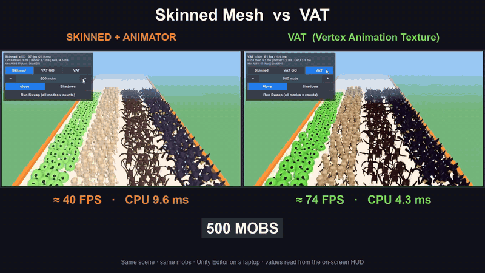

# Unity Vertex Animation Textures (VAT)

Animate huge crowds in Unity (URP) by baking skeletal animation into textures and playing it back in a vertex shader, with no bones, Animator or skinning at runtime.

The project includes a baker, an instanced VAT shader and a benchmark scene that compares **Skinned Mesh + Animator** against **VAT** with the same characters.

*Same scene, 500 → 1,000 → 2,000 characters. Click the animation for the full-quality MP4.*

## What is VAT?

A normal animated character has a skeleton. Every frame the game evaluates the animation, updates every bone and deforms the mesh. That is fine for a few characters and expensive for thousands.

VAT moves that work offline:

1. **Bake:** play each animation clip in the editor and record the deformed position (and normal) of every vertex on every frame.
2. **Store:** write those values into textures. Each pixel holds one vertex's position for one frame.
3. **Play:** at runtime the character is a static mesh. The vertex shader computes the current frame from time and reads each vertex's position from the texture.

The CPU only says "play Run" once. Characters of the same type share one mesh and material, so they are drawn with GPU instancing in a handful of draw calls.

## Results

Same scene, same characters, shadows off, measured in the Unity Editor on a laptop (Acer Nitro AN515-57, Direct3D 11). Not yet measured on a phone.

| 2,000 characters | Skinned + Animator | VAT |
|---|---|---|
| Frame rate | ~20 FPS | ~69 FPS |
| Main-thread CPU time | ~26 ms | ~5 ms |
| Draw calls (characters) | ~14,000 | 8 |

The table above is read from the on-screen stats in the comparison video. The scaling table below comes from two automated benchmark sweeps (averaged) on an earlier version of the scene layout, so its numbers differ slightly:

Scaling (main-thread CPU ms):

| Characters | Skinned | VAT |
|---|---|---|
| 500 | 9.4 | 4.0 |
| 1,000 | 17.8 | 5.4 |
| 2,000 | 31.1 | 5.4 |
| 4,000 | 65.8 | 6.2 |

Both modes render the same number of triangles. GPU skinning was enabled for the skinned baseline.

## Getting started

Requirements: Unity **6000.6.2f1** (Unity 6), Universal Render Pipeline 17.6.

1. Open the project and run **Tools > VAT > Bake All Monsters (Animated Monster Pack)**.
   Output goes to `Assets/VAT/Baked/<Model>/` (mesh, textures, material, data asset and a ready-to-use prefab).
2. Open `Assets/VAT/Scenes/VATBenchmark.unity` and press Play.
3. Use the on-screen panel to switch between **Skinned**, **VAT GO** and **VAT**, change the character count, or run an automatic **Sweep** that saves a CSV of results.

To bake your own model (including Mixamo characters), open **Tools > VAT > Baker Window**.

## Project layout

| Path | Purpose |
|---|---|
| `Assets/VAT/Editor/VATBaker.cs` | Samples clips (Generic or Humanoid rigs), bakes vertex positions/normals into RGBAHalf textures, builds the VAT mesh, material and prefab |
| `Assets/VAT/Editor/VATBakerWindow.cs` | Baker UI: pick a model, add extra animation files, set loop flags and FPS |
| `Assets/VAT/Shaders/VATCommon.hlsl` | Time-to-frame math and texture lookup in the vertex shader |
| `Assets/VAT/Shaders/VATLit.shader` | Lightweight lit shader with ShadowCaster, DepthOnly and DepthNormals passes |
| `Assets/VAT/Runtime/VATAnimator.cs` | VAT on regular GameObjects (MaterialPropertyBlock, updated only when the clip changes) |
| `Assets/VAT/Runtime/VATInstancedRenderer.cs` | VAT with no GameObjects, using `Graphics.RenderMeshInstanced` (1,023 per batch) |
| `Assets/VAT/Runtime/VATBenchmark.cs` | Crowd spawner, benchmark modes, on-screen stats and sweep |

A longer technical walkthrough is in [`Assets/VAT/README.md`](Assets/VAT/README.md).

## Trade-offs

- In this basic setup, switching animations is an instant cut. Blending between clips is possible but needs extra texture reads in the shader.
- Texture memory grows with vertices × frames. The four monsters here (2,000 to 3,000 vertices each) use about 6 to 9 MB each.
- No IK, ragdolls or bone attachments out of the box.

## Credits

- [Animated Monster Pack](https://www.patreon.com/quaternius) by Quaternius, CC0 1.0 (public domain).
- Character and animation "Walk With Briefcase" from [Mixamo](https://www.mixamo.com) (Adobe), used to test baking a humanoid model.
